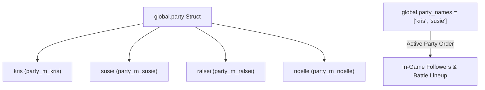

# Party management and the Light World

DELTARUNE's storytelling is built on the contrast between Hometown (the grounded, nostalgic **Light World**) and the fantastical realms (the **Dark World**), alongside dynamic party dynamics between Kris, Susie, Ralsei, and Noelle.

tlDR Engine implements a unified party management architecture (`scripts/party_init/`, `scripts/party_scripts/`) and full dual-world switching (`o_dev_world`, `world_switch()`).

This chapter covers how the party data structures work, how to add/remove companions, how to handle the Light World, and how to manage the enemy Recruits system.

---

## How the party system works

All party member definitions reside in `scripts/party_init/party_init.gml`. When the game starts, the engine initializes `global.party` containing structs for each character (`party_m_kris`, `party_m_susie`, `party_m_ralsei`, `party_m_noelle`).



### Active Party Array (`global.party_names`)

The `global.party_names` array controls who is currently following Kris in the overworld and who participates in combat:

```gml
// Check who is in the active party
if party_contains("susie") {
    // Susie is present!
}

// Get the number of active party members
var count = party_length(true);
```

---

## 1. Adding and removing party members

You can modify party composition on the fly in cutscenes, room triggers, or plot milestones using built-in party helpers (`scripts/party_scripts/party_scripts.gml`):

### Adding a member (`party_member_add`)

```gml
// Adds Susie to the active party and creates her follower next to the leader
party_member_add("susie");

// Smoothly align the follower trail behind the leader
party_member_interpolate("susie");
```

`party_member_add(name, _x, _y, _recalculate_positions)` pushes the name onto `global.party_names` and creates the follower instance (`scripts/party_scripts/party_scripts.gml:16`). `_x` and `_y` default to the leader's position.

### Removing a member (`party_member_kick`)

```gml
// Removes Noelle from the party and deletes her follower
party_member_kick("noelle");
```

### Checking and modifying party stats

```gml
// Read a character's current HP or Attack
var kris_hp = party_getdata("kris", "hp");
var susie_atk = party_getdata("susie", "attack");

// Heal or hurt a character
party_heal("susie", 50);
party_hurt("kris", 20);

// Heal the entire team
party_heal_all(100);

// Modify a stat directly
party_setdata("kris", "max_hp", 120);
```

---

## 2. The Light World vs. Dark World

When you switch between worlds, the engine transforms gameplay rules and visual aesthetics:

| Feature | Dark World (`WORLD_TYPE.DARK`) | Light World (`WORLD_TYPE.LIGHT`) |
|---|---|---|
| **Kris Appearance** | Blue skin, silver armor, cape | Striped green sweater, brown skin |
| **Pause Menu** | Full `o_ui_menu` (ITEMS, EQUIP, POWER, CONFIG) | Minimal `o_ui_menu_lw` (ITEM, STAT, CELL, CONFIG) |
| **Stats Display** | HP, Attack, Defense, Magic, TP Bar | HP, LV, EXP, Next, Guts |
| **Equipment** | Magic Swords, Axes, Scarves, Ribbons | School Pencils, Wristwatches, Bandages |

### Building a Light World room

To make any room a Light World room:

1. Place **`o_dev_world`** on the `Instances` layer (depth `300`).
2. Open its **Variable Definitions** in the Inspector.
3. Set **`world`** to **`WORLD_TYPE.LIGHT`**.

When the room loads, `o_dev_world` calls `world_switch(WORLD_TYPE.LIGHT)` (`scripts/misc/misc.gml:287`), which sets `global.world` and converts the **leader's** equipment (`convert_leader_equipment()`). From then on, the rest of the engine reads `global.world`:
- Party sprites switch to their `_light` variants, e.g. `spr_kris_down_light` (`scripts/party_scripts/party_scripts.gml:268`).
- Items with an `lw_counterpart` are converted (`scripts/misc/misc.gml:250`).
- The pause menu opens `o_ui_menu_lw` instead of the Dark World menu.

`world_switch` does **not** remove anyone from the party. Who follows Kris in the Light World is still `global.party_names` — use `party_member_kick` if a scene needs Kris alone.

---

## 3. Dual-World item counterparts

In DELTARUNE, items change form between worlds (a spooky sword in the Dark World becomes a Halloween pencil in the Light World; a pile of dark candy becomes a pile of chalk).

In your item definitions, use `lw_counterpart` and `dw_counterpart`:

```gml
// Dark World Item definition
function item_w_spookysword() : item_weapon() constructor {
    name = ["Spookysword"];
    stats = { attack: 2 };
    
    // Automatically transforms into this item when entering the Light World
    lw_counterpart = item_w_lw_halloween_pencil;
}

// Light World Item definition
function item_w_lw_halloween_pencil() : item_weapon() constructor {
    name = ["Halloween Pencil"];
    stats = { attack: 1 };
    
    // Automatically transforms back when entering the Dark World
    dw_counterpart = item_w_spookysword;
}
```

---

## 4. The Recruits System (`recruits.gml`)

In DELTARUNE Chapter 2, sparing enemies repeatedly recruits them to Castle Town. tlDR Engine tracks recruit progress in `scripts/recruits/recruits.gml`.

### How recruits work

An enemy is recruitable when its `recruit` field holds a recruit struct. The base `enemy()` sets `recruit = new enemy_recruit()`; the virovirokun overrides it with its own (`scripts/enc_enemies/enc_enemies.gml:261`). Recruit structs live in `scripts/enc_enemies_recruits/enc_enemies_recruits.gml` and inherit from `enemy_recruit()`, whose `need` field is how many spares it takes (default `2`):

```gml
// scripts/rpg_enc_recruits/rpg_enc_recruits.gml
function enemy_recruit_sonso(data = {progress: 0}) : enemy_recruit(data) constructor {
    need    = 3                 // spare him 3 times to recruit him
    sprite  = spr_ex_e_tasque
    bgcolor = c_orange
}

// inside rpg_enemy_sonso()
recruit = new enemy_recruit_sonso()
```

Sparing advances progress with `recruit_advance(enemy)` (`scripts/recruits/recruits.gml:3`), called from the spare cutscene in `scripts/cutscene_shortcuts/cutscene_shortcuts.gml`. Defeating a recruitable enemy calls `recruit_lose`, after which it can no longer be recruited (`recruit_islost`).

### Checking recruit status in scripts

All the recruit functions take an **enemy struct**:

```gml
var _virovirokun = new enemy_virovirokun();

if recruit_isrecruited(_virovirokun) {
    // Spawn the NPC in your town room!
}
var _progress = recruit_get_progress(_virovirokun);   // how many spares so far
var _need     = recruit_getneed(_virovirokun);        // how many it takes
```

---

## Tutorial: Your first party join cutscene in 5 steps

Let's script a scene where Kris meets Susie in a room, speaks with her, and Susie joins the active party.

---

### Step 0 — Place Susie as an overworld NPC

1. In your room on the `Instances` layer, place an `o_ow_npc`.
2. Set its sprite to `spr_susie_down`.
3. Give this instance the name `inst_susie_npc`.

---

### Step 1 — Write the recruitment interaction code

In `inst_susie_npc`'s **Instance Creation Code**:

```gml
// If Susie is already in the party, remove this standalone NPC
if party_contains("susie") {
    instance_destroy();
    exit;
}

interaction_code = function() {
    cutscene_create();
    cutscene_player_canmove(false);
    
    // 1. Dialogue
    cutscene_dialogue([
        "{char(susie, 0)}* Hey Kris.",
        "{char(susie, 4)}* You ready to explore? Let's go!"
    ]);
    
    // 2. Susie joins the team
    cutscene_func(function(npc_inst) {
        // Add Susie to the party and create her follower
        party_member_add("susie");
        party_member_interpolate("susie");
        
        // Destroy the static NPC instance
        instance_destroy(npc_inst);
        audio_play(snd_item);
    }, [id]);
    
    cutscene_player_canmove(true);
    cutscene_play();
};
```

---

### Step 2 — Test and verify checklist

Run your game (`F5`):

- [ ] Approaching the Susie NPC and pressing confirm triggers dialogue.
- [ ] After dialogue finishes, the standalone NPC disappears and Susie lines up cleanly behind Kris.
- [ ] Opening the pause menu (`[C]`) shows Susie's HP, equipment, and spells.
- [ ] Entering a battle encounter brings both Kris and Susie into combat.

---

## Common problems

| Symptom | Cause |
|---|---|
| Light World room still shows Dark World menu and sprites | `o_dev_world` was missing or its `world` variable definition was not set to `WORLD_TYPE.LIGHT` |
| Follower teleports across screen when added | Forgot to call `party_member_interpolate(name)` right after `party_member_add(name)` |
| Dual-world item disappears when changing rooms | `lw_counterpart` or `dw_counterpart` was written as a string instead of a script reference |
| Party member stats show 0 in battle | Character was not registered in `scripts/party_init/party_init.gml` |
